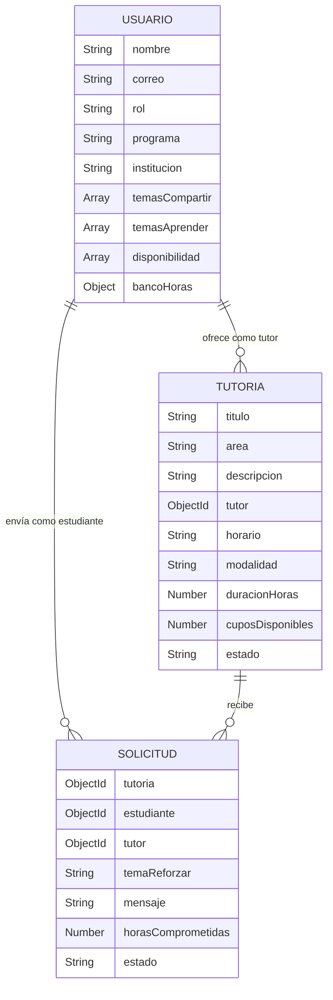

# Modelo General - EDU-KT Free

El modelo Solicitud existe en MongoDB; su flujo web aún es una demostración. El rol ambos combina estudiante y tutor. Los usuarios también almacenan entraId y activo.

Este documento describe cómo se organiza y guarda la información de la plataforma en la base de datos (**MongoDB Atlas**). La idea principal es separar el inicio de sesión (que se maneja de forma segura con **Microsoft Entra ID**) de los datos académicos y de las tutorías que usa la página en el día a día.

## Cómo se conectan los datos

El sistema cuenta con tres grupos principales de información que se relacionan entre sí:

## Qué guarda cada parte

### 1. Usuarios
Aquí se guarda el perfil académico de cada persona que hace parte de la comunidad:
- **Datos básicos:** su nombre, correo, programa académico e institución educativa.
- **Rol dentro de la red:** define si participa como estudiante, como tutor o como administrador.
- **Intereses y horarios:** los temas que domina y puede enseñar, los temas en los que busca apoyo y los horarios en los que tiene disponibilidad.
- **Banco de horas:** lleva la cuenta de las horas de tutoría que ha ofrecido a otros compañeros y las horas de apoyo que ha recibido, fomentando el intercambio solidario.

### 2. Tutorías
Representa los espacios de acompañamiento publicados en la plataforma:
- Incluye el título de la materia o tema, el área de conocimiento y una descripción clara de lo que se va a trabajar.
- Está conectada con el **usuario tutor** que la ofrece.
- Indica el horario, la modalidad (virtual, presencial o híbrida), la duración, los cupos disponibles y el estado actual de la tutoría.

### 3. Solicitudes
Guarda los mensajes y peticiones cuando un estudiante solicita apoyo en una tutoría:
- Conecta al estudiante que pide la ayuda con el tutor y la tutoría seleccionada.
- Registra el tema específico que el estudiante necesita reforzar, un mensaje breve para coordinar el encuentro y el estado de la solicitud (pendiente, aceptada, completada o rechazada).
